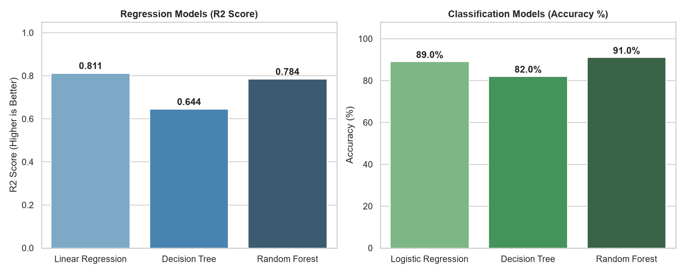
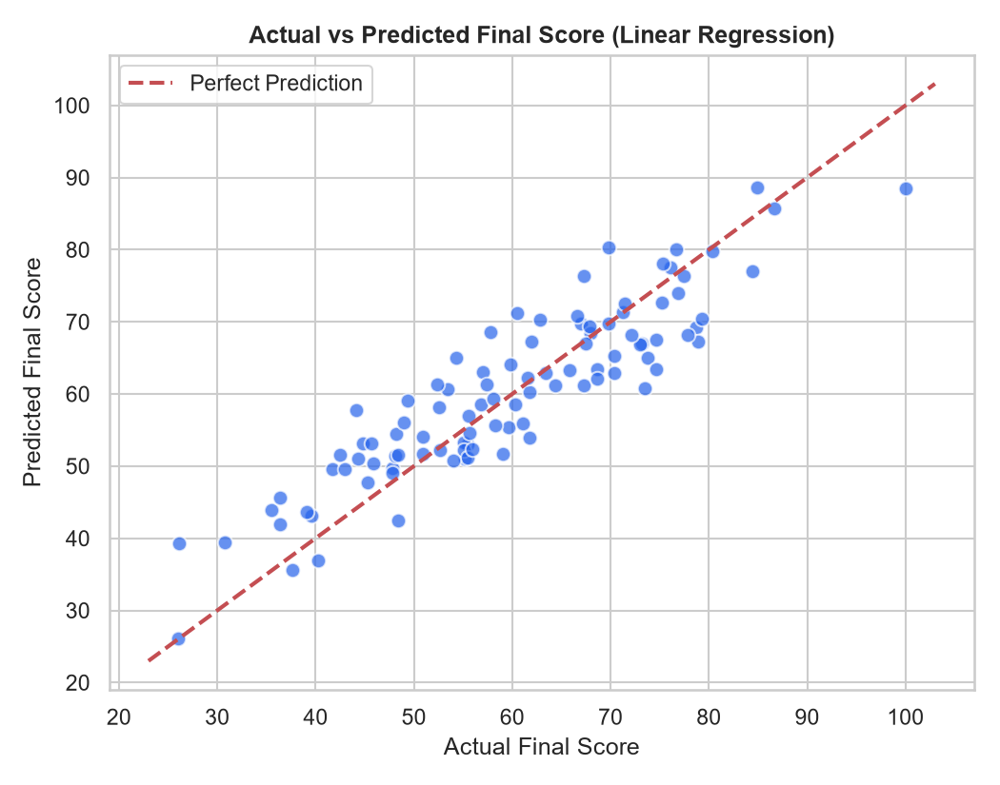
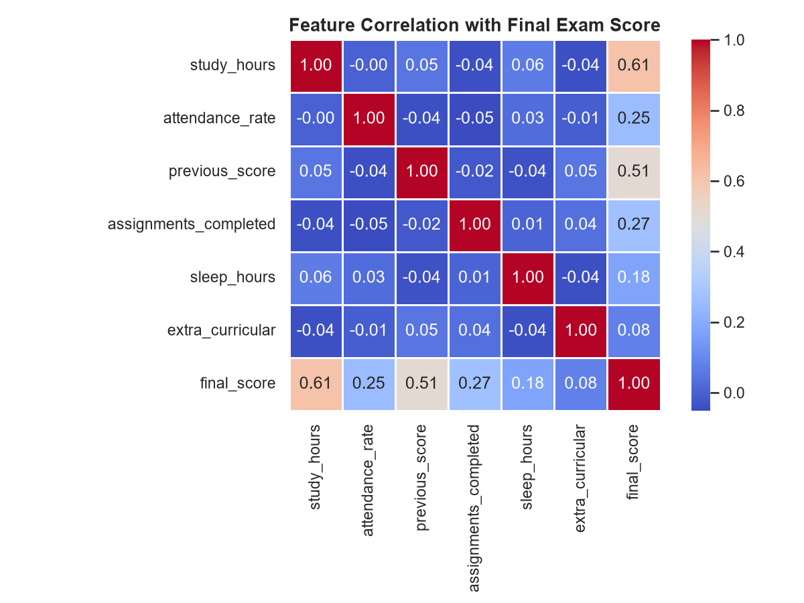
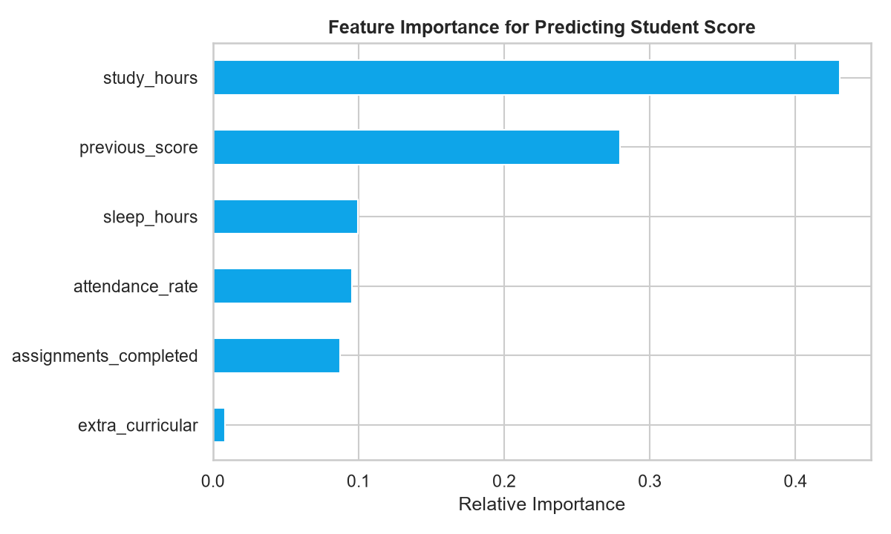

# Predicting Student Performance using Supervised Learning

A clean, beginner-friendly Machine Learning project that uses **Supervised Learning** algorithms to predict:
1. **Final Exam Score** (Regression) — numeric score out of 100
2. **Exam Result** (Classification) — `Pass` or `Fail`

---

## Project Overview

Predicting student performance early helps educators identify at-risk students and understand which study habits matter most. This project compares three classic supervised learning algorithms for both regression and classification tasks using `scikit-learn`.

### Dataset Features (`data/student_performance.csv`)

The dataset contains **500 student records** with the following columns:

| Column | Description | Range / Values |
| :--- | :--- | :--- |
| `study_hours` | Average daily study hours | `0.5 – 8.0` |
| `attendance_rate` | Class attendance percentage | `40% – 100%` |
| `previous_score` | Previous exam score | `20 – 98` |
| `assignments_completed` | Assignments submitted out of 10 | `1 – 10` |
| `sleep_hours` | Average daily sleep hours | `4.5 – 9.5` |
| `extra_curricular` | Extra-curricular participation | `0` (No), `1` (Yes) |
| `final_score` *(Target 1)* | Final exam score out of 100 | `18.2 – 100.0` |
| `result` *(Target 2)* | Final outcome (`Pass` if score ≥ 50) | `Pass` / `Fail` |

---

## Algorithms & Results

### 1. Regression Models (Predicting Final Score)

| Model | R² Score | MAE | RMSE |
| :--- | :---: | :---: | :---: |
| **Linear Regression (Best)** | **0.8113** | **5.09** | **6.16** |
| Random Forest Regressor | 0.7840 | 5.47 | 6.59 |
| Decision Tree Regressor | 0.6441 | 6.84 | 8.46 |

### 2. Classification Models (Predicting Pass / Fail)

| Model | Accuracy | F1 Score (Pass) |
| :--- | :---: | :---: |
| **Random Forest Classifier (Best)** | **91.00%** | **0.9448** |
| Logistic Regression | 89.00% | 0.9317 |
| Decision Tree Classifier | 82.00% | 0.8861 |

---

## Visual Results

### Model Comparison


### Actual vs Predicted Final Score


### Feature Correlation & Importance
| Correlation Heatmap | Feature Importance |
| :---: | :---: |
|  |  |

**Key Takeaway:** `study_hours` and `previous_score` have the strongest positive impact on a student's final exam score, followed by `attendance_rate`, `assignments_completed`, and balanced `sleep_hours`.

---

## Project Structure

```text
student-performance-prediction/
├── data/
│   └── student_performance.csv          # Student dataset (500 records)
├── notebooks/
│   └── student_performance_analysis.ipynb  # Step-by-step Jupyter walkthrough
├── src/
│   ├── train_model.py                   # Trains models, evaluates & saves charts
│   └── predict.py                       # Predicts score & Pass/Fail for new students
├── outputs/
│   ├── model_comparison.png
│   ├── actual_vs_predicted.png
│   ├── correlation_heatmap.png
│   └── feature_importance.png
├── requirements.txt                     # Python dependencies
├── .gitignore
└── README.md
```

---

## How to Run

### 1. Clone the repository
```bash
git clone https://github.com/Lipaksh3/student-performance-prediction.git
cd student-performance-prediction
```

### 2. Install dependencies
```bash
pip install -r requirements.txt
```

### 3. Train the models and generate charts
```bash
python src/train_model.py
```

### 4. Predict performance for a student
Run sample demo predictions:
```bash
python src/predict.py --demo
```

Or enter your own student details interactively:
```bash
python src/predict.py
```

---

## Tech Stack

- **Language:** Python 3
- **Data Processing:** Pandas, NumPy
- **Machine Learning:** Scikit-learn
- **Visualization:** Matplotlib, Seaborn
